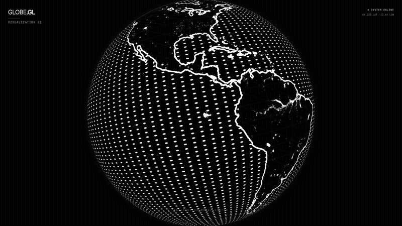

# ais-rotating-earth

A dot-matrix 3D Earth visualization built with custom GLSL shaders. Continents rendered as a grid of white dots, coastlines traced with real-time edge detection, wrapped in a subtle wireframe graticule.

## Quick Start

```bash
git clone https://github.com/andrewvoirol/ais-rotating-earth.git
cd ais-rotating-earth
npm install
npm run dev
```

Open [http://localhost:3000](http://localhost:3000)

## How It Works

Drag to orbit, scroll to zoom. The globe auto-rotates at a slow drift.

Under the hood, a custom fragment shader samples a 2K specular map to distinguish land from ocean. Land pixels get a dot-matrix pattern (UV-space grid with `smoothstep` circles), while coastlines are detected via a Sobel-like edge filter on the mask — sampling 4 neighbors and thresholding the gradient. An occlusion sphere behind the globe hides back-face dots, and a separate atmosphere shader produces the edge glow using view-angle falloff.

## Screenshots

| Default View | Rotated |
|:---:|:---:|
|  |  |

## Tech Stack

| Layer | Technology |
|-------|-----------|
| Framework | React 19 |
| 3D Engine | Three.js + React Three Fiber |
| Shaders | Custom GLSL (vertex + fragment) |
| Styling | Tailwind CSS 3.4 |
| Build | Vite 6 |
| Language | TypeScript |

## License

MIT
